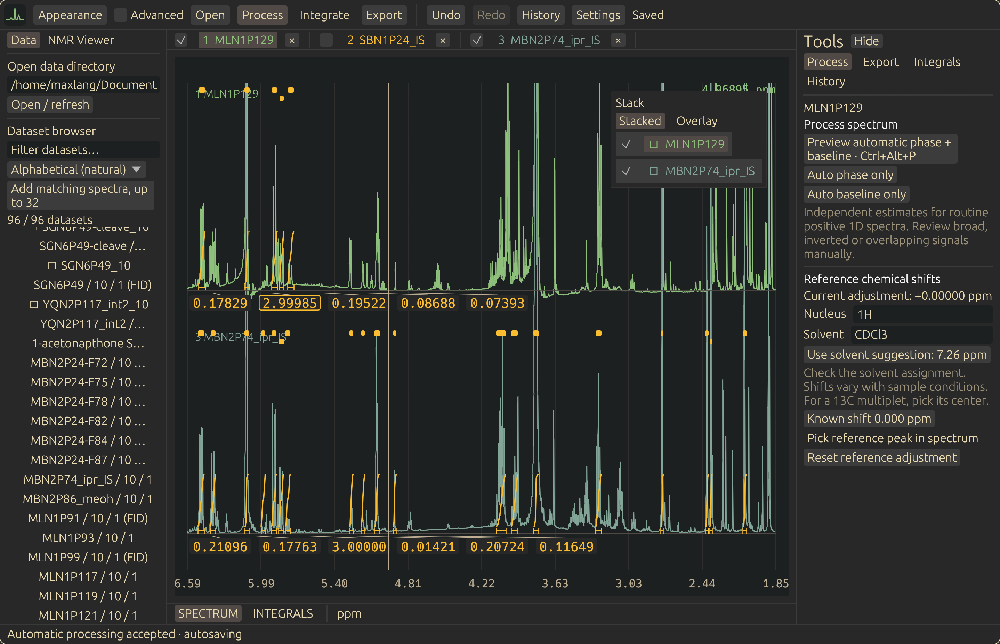

# NMR Viewer

NMR Viewer is a Rust desktop application for exploring and processing Bruker 1D NMR data. It opens datasets in a searchable folder browser, displays spectra individually or in a stack, and saves processing edits in a separate project. It also offers a TopSpin-inspired appearance.



## What it does

- Browse nested Bruker datasets and compare spectra in a stack.
- Adjust phase and polynomial baseline, reference chemical shifts, and integrate and normalize peaks.
- Preview automatic phase and baseline correction before accepting it.
- Save edits automatically and export spectra and integrals as CSV or as a new Bruker dataset.

The automatic algorithms target routine positive 1D spectra. Review results for broad or inverted signals. The project does not claim full TopSpin processing parity; see [native processing validation](NATIVE-PROCESSING-VALIDATION.md) for the tested boundary.

## Build and run

The provided build script uses Nix and a Rust toolchain. Its shell currently obtains nixpkgs from `/etc/nixos`, so it assumes a NixOS flake at that path. Adapt `rust-shell.nix` to your nixpkgs source if your system uses a different setup.

```sh
bash build-rust.sh
bash run.sh
# Optionally pass dataset or project directories:
bash run.sh /path/to/data
```

The first command builds an optimized binary and records its runtime library path. Subsequent launches use that binary without rebuilding. A graphical Linux session with Wayland or X11 is required.

## First steps

1. Choose **Open** and select a Bruker dataset or a parent folder. The browser searches nested folders; click a dataset to display it.
2. Use **Process** to preview automatic correction, or enable **Advanced** for manual phase and baseline controls. Accept or cancel the preview after comparing it.
3. Hold Shift and drag across a peak to integrate it, or choose **Integrate**. Double-click an integral value to set its proton count. Hover over a value and press D to delete it.
4. Choose **Export** to write CSV files or a fresh Bruker dataset to a separate directory.

Hover over another dataset and press S to add it to a stack. Scroll above the baseline to adjust the hovered spectrum's intensity, and below it to zoom the ppm axis. Press Home to restore the full ppm range. Undo with Ctrl+Z and redo with Ctrl+Shift+Z or Ctrl+Y.

Opening a dataset creates or reopens a project under `~/Documents/NMR Projects`. Processing and integration edits autosave there; the original Bruker files remain untouched. Named checkpoints are available under **Tools → History / checkpoints**. See [project format](PROJECT-FORMAT.md) for the stored files and export behavior.

## Code map

The application entry point is [rust/main.rs](rust/main.rs). The desktop UI is built with `eframe`/`egui`.

- [rust/browser.rs](rust/browser.rs) discovers datasets and manages the browser.
- [rust/data.rs](rust/data.rs), [rust/raw.rs](rust/raw.rs), and [rust/processing.rs](rust/processing.rs) handle data and processing.
- [rust/project.rs](rust/project.rs) and [rust/storage.rs](rust/storage.rs) manage projects and persistence; [rust/bruker_export.rs](rust/bruker_export.rs) writes Bruker exports.
- [rust/ui.rs](rust/ui.rs), [rust/native_ui.rs](rust/native_ui.rs), and [rust/topspin_mode.rs](rust/topspin_mode.rs) implement the interface and appearances.
- [tests](tests) contains tests and parity audit tools. The earlier Java viewer and reference material remain in the repository.

Run the Rust tests and lint checks in the development shell:

```sh
nix-shell rust-shell.nix --run 'cargo test && cargo clippy -- -D warnings'
```

For more controls and implementation details, see [RUST.md](RUST.md). The [TopSpin appearance verification](TOPSPIN-APPEARANCE-VERIFICATION.md) describes the reference comparison and its limits.
